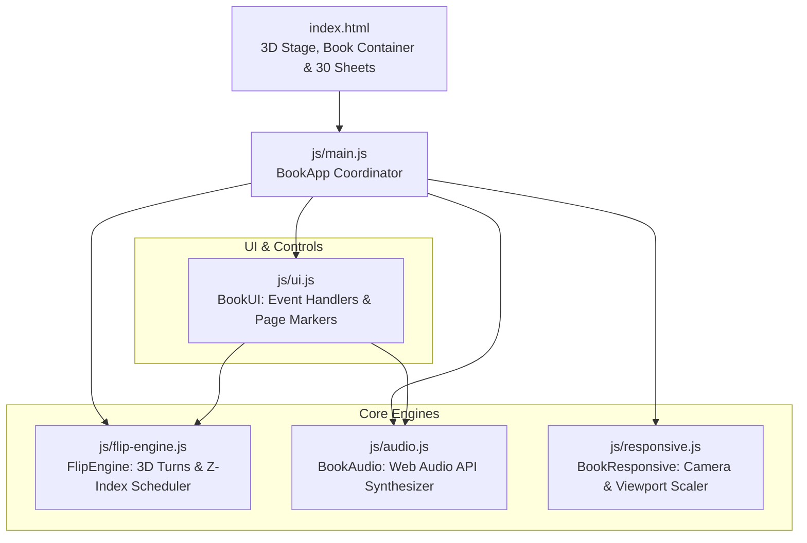

# Lumina & Form — Technical Documentation Hub

Welcome to the comprehensive technical documentation for the **Lumina & Form** interactive 3D book engine. This documentation suite covers the complete architectural, mathematical, physical, and implementation details of the application.

---

## 📚 Documentation Directory

| Document | Description |
| :--- | :--- |
| **[Architecture & Workspace Design](architecture.md)** | System topology, modular boundaries, unidirectional data flow, DOM hierarchy, and lifecycle execution. |
| **[3D Flip Mechanics & Physics Engine](flip-mechanics-3d.md)** | 3D coordinate matrices, $-180^\circ$ Y-axis rotation physics, multi-page rapid flipping engine, and mathematical z-index scheduling. |
| **[Fore-Edge 3D Page Markers](page-markers-3d.md)** | Geometry of protruding tabs, upright double-sided 3D typography, hover elevation, and avoidance of 3D context flattening. |
| **[Lighting Simulation & Procedural Audio](lighting-and-audio.md)** | Dynamic shading overlays, spine gutter gradients, desk drop shadows, and Web Audio API white noise / bandpass synthesis. |
| **[Responsive Camera & Viewport Scaling](responsive-and-camera.md)** | Viewport fit algorithm, zoom multiplier (`1.15`), scale bounds clamp, and hardcover board overhang geometry. |
| **[Customization & Extension Cookbook](customization-guide.md)** | Step-by-step instructions for adding sheets, editing content, attaching new markers, adjusting typography, and changing themes. |
| **[API Reference Specification](api-reference.md)** | Exhaustive class interfaces, methods, constructor parameters, return values, events, and global debugging hooks. |
| **[Troubleshooting & CSS 3D Pitfalls](troubleshooting-and-pitfalls.md)** | Analysis of common 3D rendering traps (CSS `filter` flattening, inverted Z-axes in flipped space, stacking context race conditions). |
| **[Filler Sheets & Procedural Fantasy Mess](filler-sheets-and-fantasy-mess.md)** | Rationale, generator architecture, and replacement guide for temporary procedural filler content avoiding empty paper. |

---

## 🏗 System Topology Overview



---

## 🚀 Quick Reference Commands

### Running Locally
```bash
python3 -m http.server 3088
```
Navigate to: `http://localhost:3088`

### Developer Console Hooks
At runtime, the initialized application instances are accessible directly on the global `window` object:
```javascript
// Access the main application coordinator
window.bookApp

// Access the 3D flip engine instance
window.bookInstance
window.bookApp.engine

// Jump to any page with cascading multi-flip animation
window.bookApp.engine.goToLocation(13); // Title Page

// Adjust camera zoom on the fly
window.bookApp.responsive.setZoom(1.25);

// Toggle procedural audio synthesis
window.bookApp.audio.toggleSound();
```
