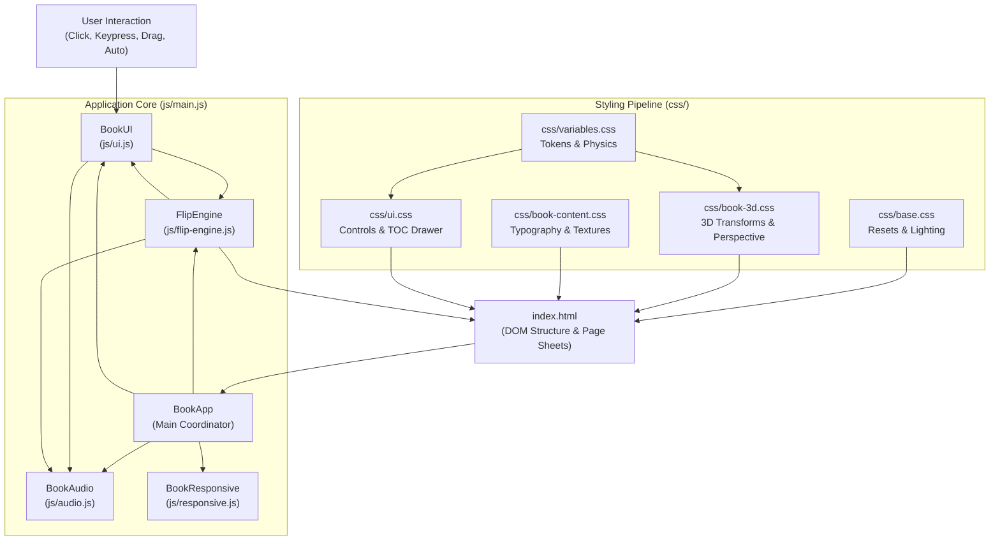

# System Architecture & Workspace Design

This document details the architectural principles, component topology, module boundaries, and execution lifecycle of the **Lumina & Form** 3D Book codebase.

---

## 1. Architectural Philosophy

1. **Zero External Runtime Dependencies**: The entire experience is built using standard web technologies: HTML5, CSS3, and ES6 JavaScript. No external bundlers, compilers, or heavyweight 3D libraries (such as Three.js) are needed.
2. **GPU Hardware Acceleration**: All spatial transitions use GPU-accelerated 3D transforms (`transform: rotateY()`, `translate3d()`, `perspective`), avoiding costly DOM layout reflows (`top`, `left`, `margin`).
3. **Strict Separation of Concerns**:
   - `flip-engine.js`: Handles 3D geometry, leaf state tracking, z-index hierarchy, and rotation classes.
   - `audio.js`: Encapsulates Web Audio API synthesis without polluting presentation logic.
   - `ui.js`: Manages user controls, scrub slider, TOC drawer, and keyboard event bindings.
   - `responsive.js`: Dynamically manages aspect-ratio fitting and viewport scaling.
   - `main.js`: Serves as the central dependency injection orchestrator.
4. **Modular Stylesheet Architecture**: CSS is fragmented into discrete, single-responsibility files (`variables.css`, `base.css`, `book-3d.css`, `book-content.css`, `ui.css`) that are linked directly or bundled via `styles.css`.

---

## 2. Component Topology & Relationships

---

## 3. Modular File Structure & Responsibilities

### 3.1 JavaScript Modules (`/js`)

| Module | Class | Responsibility |
| :--- | :--- | :--- |
| **`js/main.js`** | `BookApp` | Orchestrates instantiation, passes event delegates between `FlipEngine`, `BookAudio`, `BookUI`, and `BookResponsive`. Exposes `window.bookApp` and `window.bookInstance`. |
| **`js/flip-engine.js`** | `FlipEngine` | Maintains `currentLocation` state ($0 \dots N$), applies CSS rotation classes (`.flipped`), coordinates leaf z-index stacking schedules, and triggers lighting shadow animations. |
| **`js/audio.js`** | `BookAudio` | Lazily instantiates an `AudioContext` on user interaction and synthesizes physical paper friction and air woosh sound effects procedurally via Web Audio API nodes. |
| **`js/ui.js`** | `BookUI` | Binds DOM listeners for floating stage arrows, bottom dock buttons, scrub slider, TOC drawer links, auto-play interval loop, and keyboard arrows. |
| **`js/responsive.js`** | `BookResponsive` | Listens to viewport `resize` events, dynamically calculating the optimal scale factor and setting the CSS variable `--book-scale` on `:root`. |

### 3.2 CSS Modules (`/css`)

| Stylesheet | Scope |
| :--- | :--- |
| **`css/variables.css`** | Defines `:root` CSS custom properties: colors (leather, gold foil, paper tones), typography families, geometry (`--book-width: 760px`, `--book-height: 540px`), and animation easing timing. |
| **`css/base.css`** | Universal box-sizing reset, global viewport constraints, ambient glow gradients, and desk surface background. |
| **`css/book-3d.css`** | The 3D stage (`perspective: 2400px`), master book container, dynamic centering classes, `.page-sheet` transforms (`rotateY(-180deg)`), spine crease, gutter gradients, and dynamic lighting overlays. |
| **`css/book-content.css`** | Hardcover embossed leather textures, gold foil stamping, marbled endpaper gradients, ex-libris card styling, and editorial typography (drop caps, pull quotes, SVG architectural diagrams, colophon specifications). |
| **`css/ui.css`** | Header brand typography, tool buttons, glassmorphic TOC drawer, floating circular stage arrows, bottom dock scrubber, and media queries for mobile/tablet responsive breakpoints. |

---

## 4. Execution Lifecycle & Bootstrap Sequence

1. **HTML Parsing**: The browser loads `index.html`, parses the `<link>` stylesheet references in parallel, and constructs the DOM tree.
2. **ES6 Module Loading**: The browser encounters ``, resolving `js/main.js` and its imported dependencies (`audio.js`, `flip-engine.js`, `responsive.js`, `ui.js`).
3. **Bootstrap Execution**:
   - `bootstrap()` initializes when `document.readyState` is `'complete'` or on the `DOMContentLoaded` event.
   - `new BookApp()` is constructed.
   - `BookAudio` registers one-time gesture listeners (`click`, `keydown`) to initialize `AudioContext` without violating browser autoplay policies.
   - `BookResponsive` calculates the initial `--book-scale` from the viewport dimensions.
   - `FlipEngine` scans all `.page-sheet` elements, assigns resting z-indices, and applies the initial centering class (`.state-closed-front`).
   - `BookUI` binds all UI listeners and updates the slider, location badges, and TOC highlights.
4. **Interactive Loop**: Subsequent user interactions (clicking a page, pressing an arrow key, dragging the slider) mutate `FlipEngine.currentLocation`, executing 3D animations and updating all observers.
