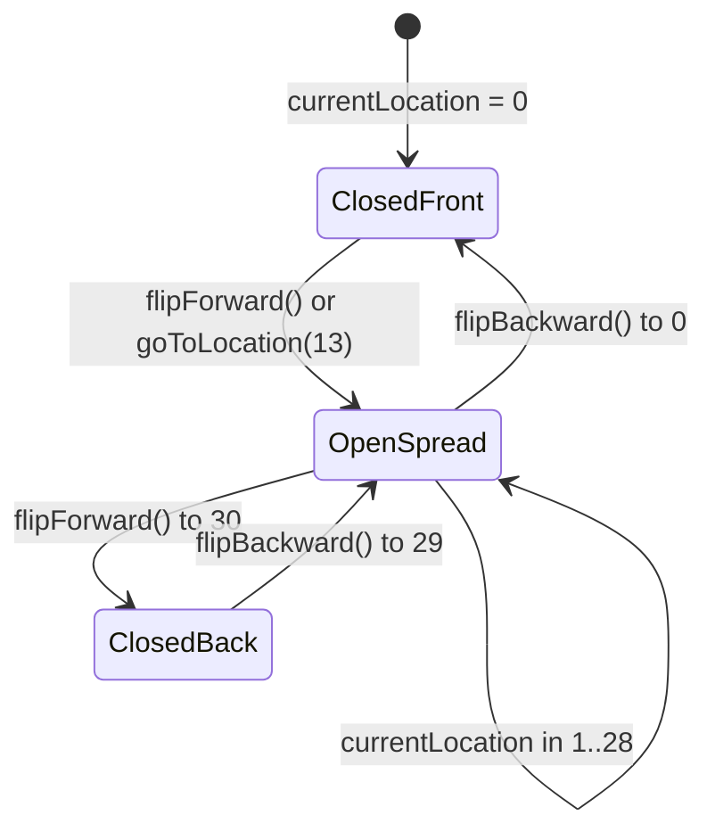

# Architecture & Workspace Design

This document details the architectural principles, component topology, module boundaries, DOM structure, and execution lifecycle of the **Lumina & Form** 3D Book codebase.

---

## 1. Architectural Philosophy

Lumina & Form is engineered as a **pure vanilla web application** utilizing native browser capabilities without third-party frameworks, bundlers, WebGL renderers, or external asset dependencies.

Key architectural pillars:
1. **Hardware-Accelerated CSS 3D Pipeline**: Pages rotate as authentic rigid 3D leaves using CSS transforms (`rotateY(-180deg)`) inside a single shared `preserve-3d` context.
2. **Deterministic State Machine**: The entire book state is governed by an integer location ($0 \le \text{location} \le \text{maxLocation}$), driving both 3D leaf transforms and dynamic camera/centering offsets.
3. **Procedural Web Audio API**: Tactile audio feedback (paper rustle, flick, crease) is generated procedurally on demand using white-noise buffers and biquad filters, eliminating external audio files.
4. **Non-Blocking Multi-Page Cascading**: Flipping across multiple sheets is asynchronous and non-blocking, tracking in-flight leaves independently with individual settle timers.
5. **Zero-Build ES6 Modules**: Source files use native ES6 module imports (`import` / `export`) loaded natively via `<script type="module">`.

---

## 2. Directory & Module Boundaries

```
book.js/
├── index.html            # Main markup: 3D stage, 30 page sheets (60 faces) & page markers
├── book.js               # Root module forwarding to js/main.js
├── styles.css            # Central CSS import manifest
├── css/
│   ├── variables.css     # Design tokens, color palette, book dimensions & easing curves
│   ├── base.css          # Resets, ambient background, scene lighting & desk surface
│   ├── book-3d.css       # 3D stage, perspective, sheets, flip transforms & spine shadows
│   ├── book-content.css  # Leather cover foil, marbled endpapers & editorial typography
│   └── ui.css            # Floating stage navigation buttons & responsive breakpoint rules
├── js/
│   ├── audio.js          # Web Audio API procedural paper rustle & flip synthesis
│   ├── flip-engine.js    # 3D rotation, dynamic z-index scheduling & in-flight tracker
│   ├── responsive.js     # Viewport auto-scaler (--book-scale) & camera zoom controller
│   ├── ui.js             # Event handlers, page marker clicks, keyboard & cover cascades
│   └── main.js           # Main application coordinator (BookApp)
└── docs/                 # Complete engineering documentation suite
```

### Module Responsibilities

| Module | Primary Responsibility |
| :--- | :--- |
| **`js/main.js`** | Orchestrates initialization, instantiates singletons, and exposes global debugging hooks (`window.bookApp`, `window.bookInstance`). |
| **`js/flip-engine.js`** | Manages sheet flipping (`flipForward`, `flipBackward`, `goToLocation`), tracks in-flight sheets in a `Set()`, calculates mathematical stacking orders (`updateZIndices`), and controls book centering classes. |
| **`js/audio.js`** | Encapsulates `AudioContext`, unlocks audio on first user gesture, generates procedural white-noise burst and bandpass sweep, and provides directional pitch variation. |
| **`js/responsive.js`** | Computes optimal `--book-scale` CSS variable based on available viewport width/height, applying a configurable `zoom` multiplier (default `1.15`). |
| **`js/ui.js`** | Binds event listeners (sheet clicks, floating stage buttons, delegated page marker clicks, keyboard shortcuts) and executes UI active state updates. |

---

## 3. DOM & Leaf Topology

The book is structured as a 3D book container containing **30 `.page-sheet` elements** (index 0 to 29), resulting in **60 readable page faces**:

```
.book-stage (perspective: 2400px; transform-style: preserve-3d)
└── .book (transform-style: preserve-3d; transform: scale(var(--book-scale)) translateX(...))
    ├── .book-spine-crease (central spine groove)
    │
    ├── #sheet-0  [Cover Board]
    │   ├── .face.front.face-cover (#page-cover: leather texture, gold foil, emblem)
    │   └── .face.back.face-inside-cover (#page-inside-front: marbled endpaper)
    │
    ├── #sheet-1 to #sheet-12 [Opening Blank Flyleaves]
    │   ├── .face.front.face-paper (.blank-page-layout)
    │   └── .face.back.face-paper (.blank-page-layout)
    │
    ├── #sheet-13 [Title Page]
    │   ├── .face.front.face-paper (#page-title: Title Page)
    │   ├── .face.back.face-paper (#page-prologue-1: Prologue Left)
    │   └── .page-marker[data-target-page="13"] (TITL tab)
    │
    ├── #sheet-14 [Prologue]
    │   ├── .face.front.face-paper (#page-prologue-2: Architectural study diagram)
    │   ├── .face.back.face-paper (#page-chap1-left: Chapter I Left)
    │   └── .page-marker[data-target-page="14"] (PROL tab)
    │
    ├── #sheet-15 [Chapter I: Memory]
    │   ├── .face.front.face-paper (#page-chap1-right: Chapter I Right)
    │   ├── .face.back.face-paper (#page-chap2-left: Chapter II Left)
    │   └── .page-marker[data-target-page="15"] (CH.I tab)
    │
    ├── #sheet-16 [Chapter II: Space]
    │   ├── .face.front.face-paper (#page-chap2-right: Chapter II Right)
    │   ├── .face.back.face-paper (#page-colophon: Colophon & Notes)
    │   └── .page-marker[data-target-page="16"] (CH.II tab)
    │
    ├── #sheet-17 [Epilogue / Flyleaf]
    │   ├── .face.front.face-paper (.blank-page-layout)
    │   ├── .face.back.face-paper (.blank-page-layout)
    │   └── .page-marker[data-target-page="17"] (EPIL tab)
    │
    ├── #sheet-18 to #sheet-28 [Closing Blank Flyleaves]
    │   ├── .face.front.face-paper (.blank-page-layout)
    │   └── .face.back.face-paper (.blank-page-layout)
    │
    └── #sheet-29 [Back Cover Board]
        ├── .face.front.face-inside-cover (#page-back-inside: FINIS note, marbled endpaper)
        └── .face.back.face-cover.back-cover (#page-back-cover: leather, gold foil, barcode)
```

---

## 4. Book Centering State Machine

The `.book` element applies dynamic centering via CSS classes depending on `currentLocation`:



| State Class | Condition | Translation | Purpose |
| :--- | :--- | :--- | :--- |
| `.state-closed-front` | `currentLocation === 0` | `translateX(calc(var(--cover-width) / -2))` | Shifts book left so the right-side front cover is centered on screen. |
| `.state-open` | `0 < currentLocation < maxLocation` | `translateX(0)` | Centers the book spine along the viewport center axis. |
| `.state-closed-back` | `currentLocation === maxLocation` | `translateX(calc(var(--cover-width) / 2))` | Shifts book right so the left-side back cover is centered on screen. |

---

## 5. Execution Lifecycle

1. **DOM Ready**: Browser parses HTML, constructs DOM, loads stylesheets (`variables.css`, `base.css`, `book-3d.css`, `book-content.css`, `ui.css`).
2. **Bootstrap (`main.js`)**:
   - Creates `BookAudio` instance (sets up user gesture listeners for Web Audio unlock).
   - Creates `BookResponsive` instance (computes `--book-scale` and attaches `window.onresize`).
   - Creates `FlipEngine` instance (assigns initial resting `z-index`, applies `.state-closed-front`, and establishes pointer events).
   - Creates `BookUI` instance (binds click listeners to stage buttons, sheets, fore-edge tabs, and keyboard shortcuts).
3. **User Interaction**:
   - User clicks cover, navigation arrow, tab, or sheet.
   - `FlipEngine` schedules turns, elevates in-flight z-indexes (`100+`), fires procedural Web Audio synthesis, and updates active UI marker states.
