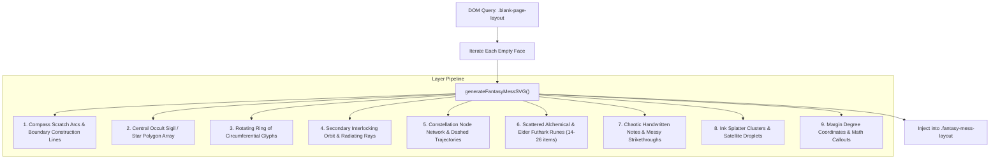

# Filler Sheets & Procedural Fantasy Mess

This document specifies the architectural rationale, procedural generation pipeline, and maintenance guidelines for the **procedural fantasy mess & arcane symbols** populated across the skipped filler sheets in **Lumina & Form**.

---

## 1. Purpose & Design Intent

### Why Filler Content Exists
In traditional physical bookbinding, books contain multiple blank flyleaves at both ends (between the inside covers and the editorial body) to protect the printed text block, cushion the binding, and establish tiered edge overhangs. In a digital 3D book experience:
1. **Preventing Barren/Empty Pages**: Completely blank white/cream pages can feel unrendered, unfinished, or visually sterile, particularly when flipped past or inspected via slider scrub.
2. **Dynamic In-Flight Visual Texture**: During fast skip-cascade transitions (jumping from cover to Title Page, or from Epilogue to Back Cover), leaves flutter past the camera in 3D perspective. Having dense graphic elements on these leaves produces a dynamic, tactile fluttering sensation reminiscent of flipping through an authentic antique volume.
3. **Proof of Feasibility (PoC)**: This implementation serves as an engineering proof-of-concept demonstrating that dynamic, procedural leaf population can be performed synchronously with zero external assets, zero layout shifts, and zero performance penalty.

> [!NOTE]
> **Status: Temporary Practice**
> This feature is explicitly designated as **temporary filler**. It stays in place for now as a working demonstration that dynamic leaf generation is entirely doable. It is designed to be cleanly replaced or modified in the future when dedicated editorial content (e.g., author essays, full-page illustrations, or technical blueprints) is ready.

---

## 2. Affected Leaf Topology

In the current **17-sheet book** (Sheets 0 to 16), the filler generator targets all unused `.blank-page-layout` containers:

| Leaf Range | Physical Location | Role in Book | Faces Populated |
| :--- | :--- | :--- | :--- |
| **Sheets 1 to 5** | Between Front Cover (0) and Title Page (6) | Opening Flyleaf Stack (Tier 1, Tier 2, Tier 3, untweaked) | 10 page faces (Front & Back) |
| **Sheet 10** | Spread opposite Colophon (`#page-epilogue`) | Epilogue Facing Leaf & Marker Tab Anchor | 2 page faces (Front & Back) |
| **Sheets 11 to 15** | Between Epilogue (10) and Back Cover (16) | Closing Flyleaf Stack (untweaked, Tier 3, Tier 2, Tier 1) | 10 page faces (Front & Back) |

* **Total Populated Faces**: 22 page faces.
* **Preserved Editorial Sheets**: Sheet 0 (Cover), Sheet 6 (Title Page), Sheet 7 (Prologue), Sheet 8 (Chapter I), Sheet 9 (Chapter II / Colophon), Sheet 16 (Back Cover).

---

## 3. Procedural Generation Architecture (`js/fantasy-mess.js`)

The generator operates as a zero-dependency pure ES6 module. For each targeted leaf face, it dynamically builds an inline scalable vector graphic (`<svg viewBox="0 0 380 532">`) containing layered, randomized arcane elements:



### Visual Element Palette
* **Alchemical & Astrological Glyphs**: `🜂`, `🜄`, `🜁`, `🜃`, `🜍`, `🜕`, `🝤`, `🝯`, `🜔`, `☉`, `☽`, `☿`, `♀`, `♂`, `♃`, `♄`, `♈`, `♉`, `♊`, `♋`, `♌`, `♍`, etc.
* **Elder Futhark & Esoteric Runes**: `ᚠ`, `ᚢ`, `ᚦ`, `ᚨ`, `ᚱ`, `ᚲ`, `ᚷ`, `ᚹ`, `ᚺ`, `ᚾ`, `ᛁ`, `ᛃ`, `ᛇ`, `ᛈ`, `ᛉ`, `ᛋ`, `ᛏ`, `ᛒ`, `ᛖ`, `ᛗ`, `ᛚ`, `ᛜ`, `ᛞ`, `ᛟ`, `⚝`, `⚚`, `✦`, `❖`, `❦`.
* **Ink Tone Palette**:
  - `#2c3e50`: Dark mystical charcoal / slate
  - `#8b3a2b`: Alchemical cinnabar / crimson blood
  - `#d4af37`: Antique gold leaf ink
  - `#8b7355`: Weathered sepia drafting ink
  - `#4a3e30`: Bistre brown
* **Scribbles & Strikethroughs**: Latin and occult aphorisms (*"NON LVX SED TENEBRAE"*, *"V.I.T.R.I.O.L."*, *"SOLVE ET COAGULA"*, *"ordo ab chao"*) rotated between $-24^\circ$ and $+24^\circ$, with randomized cross-out strike lines drawn over invalid formulas.

---

## 4. Styling & DOM Integration (`css/book-content.css`)

The generated content is wrapped in a dedicated layout container:

```css
.fantasy-mess-layout {
  position: absolute;
  inset: 0;
  width: 100%;
  height: 100%;
  overflow: hidden;
  user-select: none;
  pointer-events: none;
  display: flex;
  justify-content: center;
  align-items: center;
  opacity: 0.92;
  transition: opacity 0.3s ease;
}

.fantasy-mess-svg {
  width: 100%;
  height: 100%;
  display: block;
}
```

### Stacking Order Guarantee
Because `.fantasy-mess-layout` is placed inside the `.paper-content` element of each sheet, it is naturally integrated into the 3D sheet lighting hierarchy:
1. Paper cream background: base color (`#faf7f2`).
2. `.fantasy-mess-layout`: rendered on top of paper base.
3. `.spine-shading`: dark gradient overlay along the central book gutter (`z-index: 5`).
4. `.corner-fold-hint`: interactive triangular curl indicator (`z-index: 15`).
5. `.face-lighting-overlay`: dynamic specular lighting and flip shadow (`z-index: 10`).

---

## 5. Runtime API & Controls

The generator is automatically initialized in [`js/main.js`](file:///home/sam/Code/book.js/js/main.js) during application bootstrap. In addition, global console hooks are exposed for interactive re-randomization:

```javascript
// Re-roll fresh randomized fantasy mess across all skipped sheets
window.randomizeFantasyMess();

// Backward-compatible alias
window.randomizeStudyGraphs();
```

When navigating through filler sheets with the slider or keyboard shortcuts, [`js/ui.js`](file:///home/sam/Code/book.js/js/ui.js) updates the stage status badge to:
```
Arcane Notes • Sheet N
```

---

## 6. Future Replacement Guide

When the time comes to replace this temporary filler with permanent content:

1. **Option A: Replace with Custom HTML/Editorial Content**:
   - In `index.html`, remove the `.blank-page-layout` class from the desired sheet faces and insert regular editorial markup (e.g., `.editorial-page-layout`, text, images, or figures).
   - `populateBlankPages()` in `js/fantasy-mess.js` only targets containers with the `.blank-page-layout` class; any face with custom markup will automatically be left untouched.

2. **Option B: Replace the Generator Logic**:
   - To change the visual theme (e.g., from arcane fantasy to celestial star charts, architectural blueprints, or botanical pressings), edit `generateFantasyMessSVG()` in `js/fantasy-mess.js` without altering `flip-engine.js`, `main.js`, or `index.html`.

3. **Option C: Revert to Pure Blank Paper**:
   - Remove the `populateBlankPages(this.bookElement);` call from `js/main.js`. The empty `.blank-page-layout` containers will simply remain clean, unprinted vellum paper.
