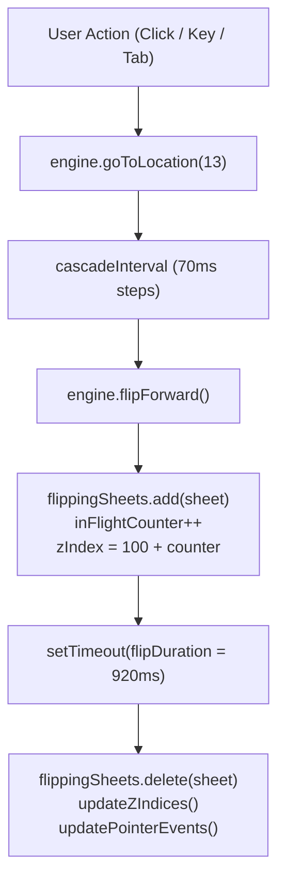

# 3D Flip Mechanics & Physics Engine

This document provides a deep mathematical, physical, and architectural specification of the 3D page flip engine, stacking order scheduling, in-flight transition tracking, and transform matrices in **Lumina & Form**.

---

## 1. 3D Coordinate Space & Transformation Matrices

The book scene uses native CSS 3D transforms within a shared 3D rendering context:

```css
.book-stage {
  perspective: 2400px;
  perspective-origin: 50% 50%;
}

.book, .page-sheet, .face, .page-marker {
  transform-style: preserve-3d;
}
```

### The Spine Pivot (`transform-origin: left center`)
Each `.page-sheet` element is positioned at `left: 50%` of the book container (anchored along the vertical spine gutter) with `transform-origin: left center`:
* **Unflipped (Resting Right Stack)**: `transform: rotateY(0deg)`
  The leaf sits flat on the right-hand side of the spine ($0^\circ$).
* **Flipped (Resting Left Stack)**: `transform: rotateY(-180deg)`
  The leaf pivots around its left edge by $-180^\circ$ into world space on the left side of the spine.

### Mathematical Transform Matrix
A rotation of $-180^\circ$ around the Y-axis produces the 3D transformation matrix:

$$\mathbf{R}_y(-\pi) = \begin{bmatrix}
\cos(-\pi) & 0 & \sin(-\pi) & 0 \\
0 & 1 & 0 & 0 \\
-\sin(-\pi) & 0 & \cos(-\pi) & 0 \\
0 & 0 & 0 & 1
\end{bmatrix} = \begin{bmatrix}
-1 & 0 & 0 & 0 \\
0 & 1 & 0 & 0 \\
0 & 0 & -1 & 0 \\
0 & 0 & 0 & 1
\end{bmatrix}$$

Notice the sign inversion of the Z-axis:
$$\begin{bmatrix} X' \\ Y' \\ Z' \\ 1 \end{bmatrix} = \mathbf{R}_y(-\pi) \begin{bmatrix} X \\ Y \\ Z \\ 1 \end{bmatrix} = \begin{bmatrix} -X \\ Y \\ -Z \\ 1 \end{bmatrix}$$

> [!IMPORTANT]
> **The Inverted Z-Axis Trap**:
> When a sheet is rotated $-180^\circ$, its local $+Z$ axis points **away from the camera** (into the screen).
> Therefore, applying a forward translation in local coordinates (`rotateY(-180deg) translateZ(1px)`) pushes the sheet **deeper** into the page stack.
> To translate forward towards the viewer in parent/world space, translations must be applied **before** the rotation:
> ```css
> transform: translate3d(0, 0, 2px) rotateY(-180deg);
> ```

---

## 2. Dynamic Mathematical Z-Index Scheduling

In a multi-leaf 3D book, CSS `z-index` determines stacking priority between sheets. As sheets turn from right to left, their stacking order must invert dynamically.

### Resting Stacking Algorithm (`updateZIndices()`)
For $N = 30$ total sheets (index $0 \le i \le 29$) and current location $L$:

1. **Left Stack ($i < L$)**:
   Sheets that have been flipped over to the left stack must stack in **ascending** order from bottom (Sheet 0) to top (Sheet $L-1$):
   $$Z_{left}(i) = i + 1$$
   * Sheet 0 has $Z = 1$ (bottom of left stack).
   * Sheet 1 has $Z = 2$.
   * Sheet $L-1$ has $Z = L$ (top of left stack).

2. **Right Stack ($i \ge L$)**:
   Sheets resting on the right stack must stack in **descending** order from top (Sheet $L$) to bottom (Sheet $N-1$):
   $$Z_{right}(i) = N - i$$
   * Sheet $L$ has $Z = N - L$ (top of right stack).
   * Sheet $N-1$ (Back Cover) has $Z = 1$ (bottom of right stack).

### In-Flight Multi-Sheet Elevation
When rapid flipping occurs, sheets in motion must fly **above** all resting stacks without clipping.

```javascript
this.flippingSheets.add(sheet);
sheet.style.zIndex = `${100 + (++this.inFlightCounter)}`;
```

* First turning sheet: $Z = 101$
* Second turning sheet: $Z = 102$
* Third turning sheet: $Z = 103$

Because later turning sheets have strictly higher z-indexes, each newly flipped page visibly folds over preceding in-flight pages in natural chronological succession.

### Hardcover Closed Dominance
When the book is fully closed, the exterior covers are guaranteed dominance over resting and in-flight sheets via explicit rules:

```css
/* Front Cover Dominance when Closed (Location 0) */
.book.state-closed-front #sheet-0 {
  z-index: 120 !important;
  transform: translate3d(0, 0, 2px);
}

/* Back Cover Dominance when Closed (Location 30) */
.book.state-closed-back #sheet-29 {
  z-index: 120 !important;
  transform: translate3d(0, 0, 2px) rotateY(-180deg);
}
```

---

## 3. Non-Blocking Rapid Multi-Page Flip Engine

Early flip engines used a rigid boolean lock:
```javascript
// ANTIPATTERN: Blocks user interaction for 920ms per page
if (this.isFlipping) return;
```

The **Lumina & Form** engine replaces this with a **concurrent tracking architecture**:



### Key Implementation Components in `js/flip-engine.js`

1. **`this.flippingSheets = new Set()`**:
   Tracks every sheet currently undergoing transition. `updateZIndices()` skips any sheet present in this set, preserving its elevated `100+` in-flight order until it completely finishes moving.
2. **`this.sheetTimeouts = new Map()`**:
   Stores the unique `setTimeout` ID for each active sheet. If a user reverses direction mid-flip, the engine clears the pending settle timer immediately and re-schedules the return turn cleanly without race conditions.
3. **`this.cascadeInterval` Cancellation**:
   Calling `goToLocation()` cancels any previously active cascade interval before initiating a new sequence:
   ```javascript
   if (this.cascadeInterval) {
     clearInterval(this.cascadeInterval);
     this.cascadeInterval = null;
   }
   ```
4. **Pointer Events Pass-Through**:
   During multi-page turns, non-top resting sheets receive `pointer-events: none` while the top visible leaves and protruding page markers maintain `pointer-events: auto !important`.

---

## 4. Subpixel Seam & Face Separation

To prevent GPU coplanar z-fighting (flickering artifacts where front and back faces overlap at identical Z depths), each face is offset:

```css
.face {
  backface-visibility: hidden;
  -webkit-backface-visibility: hidden;
  transform: translate3d(0, 0, 0);
}

.face.back {
  transform: rotateY(180deg) translateZ(0.5px);
}
```

* `.face.front` renders at $Z = 0\text{px}$.
* `.face.back` is pre-rotated $180^\circ$ and pushed forward by $+0.5\text{px}$.
* When the sheet flips $-180^\circ$, `.face.front` turns away from the camera and is culled by `backface-visibility: hidden`, while `.face.back` swings into view without depth fighting.
