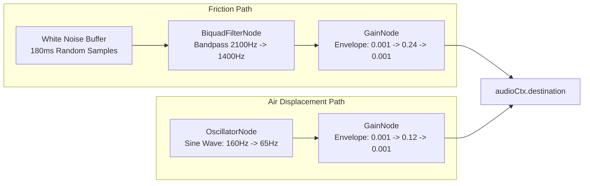

# Lighting Simulation & Procedural Audio Synthesis

This document details the physics-based lighting simulation, shadow models, and Web Audio API procedural sound synthesis in **Lumina & Form**.

---

## 1. Physics-Based Lighting Simulation

Realistic physical books do not exist in a flat ambient light field; paper bends, casts cast shadows, curves into the binding gutter, and blocks light from the desk surface beneath it.

```
       Ambient Light Glow (top-center)
                  \   |   /
                   \  |  /
             +---------------+---------------+
             | LEFT  PAGE    | RIGHT PAGE    |
             |       (Gutter | Gutter)       |
             +---------------+---------------+
             =================================
             (====== Desk Drop Shadow ======)
```

### 1.1 Central Spine Gutter Shading
Pages curving into the central binding naturally receive less light. Two linear gradient overlays simulate this page curvature:

```css
.spine-shading {
  position: absolute;
  top: 0;
  bottom: 0;
  width: 50px;
  pointer-events: none;
}

/* Left page shadow: darkness deepens towards the right spine */
.left-spine {
  right: 0;
  background: linear-gradient(to right, transparent 0%, rgba(0, 0, 0, 0.08) 60%, rgba(20, 16, 12, 0.28) 100%);
}

/* Right page shadow: darkness deepens towards the left spine */
.right-spine {
  left: 0;
  background: linear-gradient(to right, rgba(20, 16, 12, 0.28) 0%, rgba(0, 0, 0, 0.08) 40%, transparent 100%);
}
```

### 1.2 Central Spine Groove (`.book-spine-crease`)
Along the exact vertical center axis of the open book sits an 8px wide central spine crease groove:
```css
.book-spine-crease {
  position: absolute;
  top: 0;
  left: calc(50% - 4px);
  width: 8px;
  height: 100%;
  background: linear-gradient(to right, rgba(0, 0, 0, 0.45), rgba(20, 20, 20, 0.15) 50%, rgba(0, 0, 0, 0.45));
  z-index: 5;
  pointer-events: none;
  opacity: 0.9;
}
```

### 1.3 Dynamic Flip Shadow Overlays
As a sheet rotates in 3D space, its angle relative to the overhead ambient light changes:
1. When standing vertically ($90^\circ$), it obstructs light and casts deep self-shadowing.
2. When landing flat ($180^\circ$), ambient light is restored.

`FlipEngine.animateFaceShadow()` coordinates two `.face-lighting-overlay` elements:
```javascript
// Front face darkens as it stands up
frontOverlay.style.transition = `opacity ${flipDuration * 0.45}ms ease-in`;
frontOverlay.style.opacity = '0.38';

setTimeout(() => {
  frontOverlay.style.opacity = '0';
}, flipDuration * 0.48);

// Back face catches shadow as it enters verticality, then clears
backOverlay.style.opacity = '0.38';
setTimeout(() => {
  backOverlay.style.transition = `opacity ${flipDuration * 0.45}ms ease-out`;
  backOverlay.style.opacity = '0';
}, flipDuration * 0.5);
```

### 1.4 Desk Ambient Drop Shadow (`.book-desk-shadow`)
A soft radial shadow sits on the desk surface beneath the book and dynamically shifts position and aspect ratio as the book changes state:

```css
.book-desk-shadow {
  position: absolute;
  top: 50%;
  left: 50%;
  transform: translate(-50%, calc(-50% + 270px)) scaleY(0.4);
  width: 780px;
  height: 90px;
  background: radial-gradient(ellipse at 50% 50%, rgba(0, 0, 0, 0.75) 0%, rgba(0, 0, 0, 0.35) 45%, transparent 75%);
  filter: blur(16px);
  pointer-events: none;
  transition: all 0.85s cubic-bezier(0.25, 0.85, 0.35, 1.0);
}

/* Front Cover Closed: shadow shifts right to sit under closed volume */
.book.state-closed-front ~ .book-desk-shadow {
  transform: translate(calc(-50% + calc(var(--cover-width) / 4)), calc(-50% + 270px)) scaleX(0.55) scaleY(0.45);
}

/* Back Cover Closed: shadow shifts left to sit under closed volume */
.book.state-closed-back ~ .book-desk-shadow {
  transform: translate(calc(-50% - calc(var(--cover-width) / 4)), calc(-50% + 270px)) scaleX(0.55) scaleY(0.45);
}
```

---

## 2. Procedural Web Audio API Synthesis

Rather than relying on MP3/WAV audio files (which introduce latency, decoding overhead, and network failure points), all book sound effects are synthesized **in real time via the Web Audio API**.



### 2.1 Audio Context Unlock on User Gesture
Modern web browsers suspend `AudioContext` until the first user interaction:
```javascript
const initAudioContext = () => {
  if (!this.audioCtx) {
    const AudioContextClass = window.AudioContext || window.webkitAudioContext;
    if (AudioContextClass) this.audioCtx = new AudioContextClass();
  } else if (this.audioCtx.state === 'suspended') {
    this.audioCtx.resume();
  }
};

window.addEventListener('click', initAudioContext, { once: true });
window.addEventListener('keydown', initAudioContext, { once: true });
```

### 2.2 Paper Friction Synthesis (White Noise + Bandpass Filter)
A small 180ms buffer of white noise is generated:
```javascript
const bufferSize = Math.floor(ctx.sampleRate * 0.18);
const buffer = ctx.createBuffer(1, bufferSize, ctx.sampleRate);
const output = buffer.getChannelData(0);
for (let i = 0; i < bufferSize; i++) {
  output[i] = (Math.random() * 2 - 1) * 0.7;
}
```

The noise is routed through a `BiquadFilterNode` (`type = 'bandpass'`, $Q = 1.8$):
* **Forward Turn**: Sweeps from **2100 Hz** down to **1400 Hz**.
* **Backward Turn**: Sweeps from **1850 Hz** down to **1400 Hz** (slightly lower pitch reflecting reverse drag).

### 2.3 Air Displacement Woosh (Sine Oscillator)
To simulate the low-frequency air displacement of a turning leaf, a sine wave oscillator sweeps from **160 Hz** down to **65 Hz** over 150ms:
```javascript
const osc = ctx.createOscillator();
osc.type = 'sine';
osc.frequency.setValueAtTime(160, now);
osc.frequency.exponentialRampToValueAtTime(65, now + 0.15);
```

### 2.4 Gain Envelopes
Both audio paths apply exponential ramps to eliminate audio clicks and produce a natural mechanical paper decay:
* Friction gain: $0.001 \xrightarrow{\text{25ms linear}} 0.24 \xrightarrow{\text{145ms exponential}} 0.001$
* Woosh gain: $0.001 \xrightarrow{\text{20ms linear}} 0.12 \xrightarrow{\text{120ms exponential}} 0.001$
